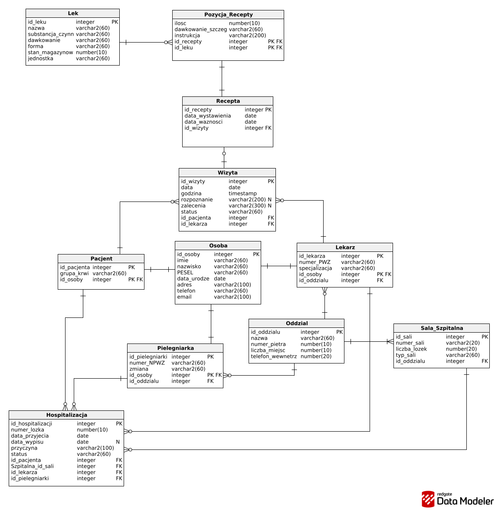

# MediCare – Hospital Management Database System

A relational database management system designed in Oracle SQL for a multi-department medical clinic and hospital facility. The system models internal healthcare operations, inpatient bed allocation, staff scheduling, clinical appointments, and hospital pharmacy inventory tracking.

## System Architecture & ERD

The database schema is fully normalized and handles entity specialization (inheriting base personal data for Patients, Doctors, and Nurses from a unified table).

### Key Features
* **Entity Inheritance Pattern:** Distinct hospital roles (`Pacjent`, `Lekarz`, `Pielegniarka`) reference the base entity `Osoba` via composite foreign keys.
* **Inpatient Tracking:** Real-time bed occupancy and department admissions (`Hospitalizacja`, `Sala_Szpitalna`, `Oddzial`).
* **Medical Consultations & Prescriptions:** Many-to-many relationship modeling patient visits, multi-item drug prescriptions, and dosage instructions (`Wizyta`, `Recepta`, `Pozycja_Recepty`, `Lek`).
* **Advanced SQL Analytics:** Includes complex reporting queries featuring correlated subqueries (`EXISTS`), analytical grouping (`GROUP BY`, `HAVING`), and multi-table relational joins.

## Database Structure

The project consists of 10 interconnected tables:
* `Osoba` – Base personal information (PESEL, contact info, personal details).
* `Pacjent`, `Lekarz`, `Pielegniarka` – Specialized medical roles and staff assignments.
* `Oddzial` & `Sala_Szpitalna` – Department structure, room types, and ward capacity.
* `Wizyta` – Outpatient appointment records, diagnoses, and medical recommendations.
* `Hospitalizacja` – Patient admission logs, bed assignments, and supervising personnel.
* `Lek` & `Pozycja_Recepty` – Pharmacy catalog, stock levels, and prescription details.

## How to Run (Oracle Database)
1. Execute `schema.sql` to generate tables, primary keys, and foreign key constraints.
2. Execute `seed_data.sql` to populate sample data.
3. Run queries from `queries.sql` to test business logic and reporting views.
